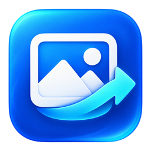
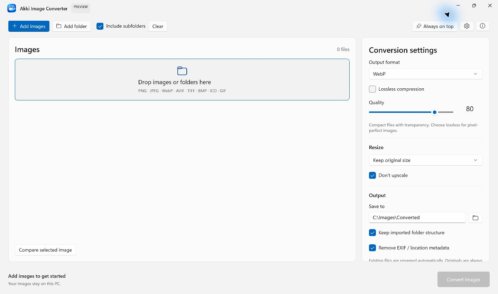
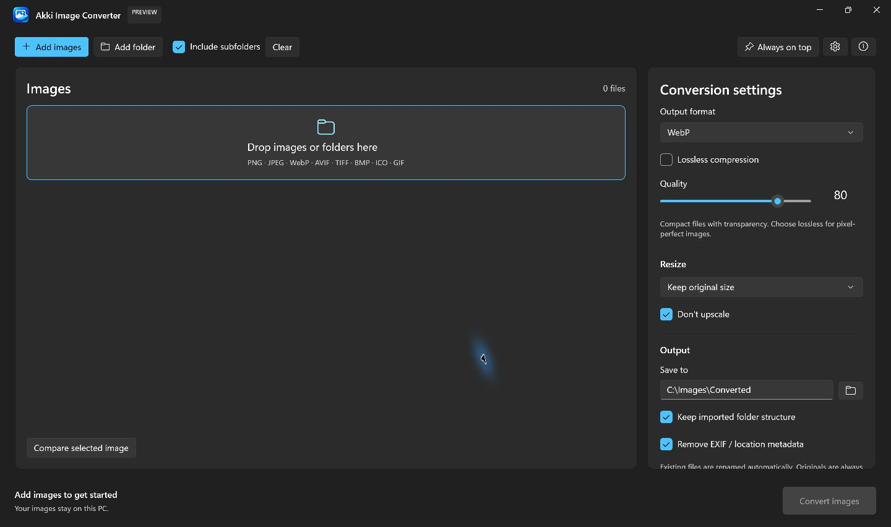
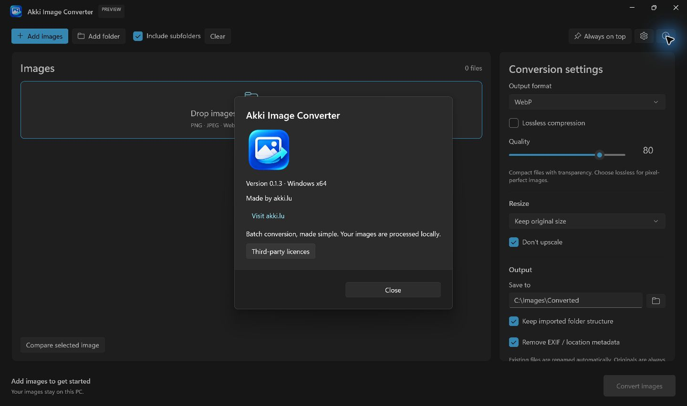

<p align="center"></p>
<h1 align="center">Akki Image Converter</h1>
<p align="center">A native Windows image converter, made by <a href="https://akki.lu">akki.lu</a>.</p>
<p align="center"><a href="https://github.com/nunolu/akki-image-converter/releases">Download for Windows</a> · <a href="https://github.com/nunolu/akki-image-converter/issues">Report an issue</a> · <a href="LICENSE">MIT licence</a></p>

Convert batches of images locally, control quality and dimensions, and keep your originals. Built with C# and WinUI 3 for **Windows 11 x64**.

## Screenshots

Actual screenshots of version 0.1.3. Choose Light, Dark, or follow Windows in Settings.

| Light mode | Dark mode |
| --- | --- |
|  |  |

<details>
<summary>About dialog and app artwork</summary>



</details>

## Download and install

Download **`lu.akki.ImageConverter-win-Setup.exe`** from the [Releases page](https://github.com/nunolu/akki-image-converter/releases). The installer includes the required runtimes, adds Desktop and Start-menu shortcuts, and provides an uninstaller. No separate codec installation is needed.

A portable ZIP is available on the same release page. Extract it completely and run `Akki.ImageConverter.exe`; installed-app updates are not available in portable mode. The installer is currently unsigned.

## Features

- Import multiple files or entire folders, optionally including subfolders.
- Drag images or folders onto the window; pin it above other windows.
- Export **WebP, JPEG, PNG, AVIF, TIFF, BMP or ICO**.
- Adjust quality or use lossless compression for supported formats.
- Resize by percentage or pixel dimensions, preserve proportions and avoid upscaling.
- Compare an original image with its actual encoded result before converting.
- Preserve transparency where supported; choose a background for JPEG/BMP.
- Optionally remove EXIF/location metadata and preserve imported folder structure.
- Keep originals; automatically rename existing output filenames.
- See progress, output sizes and individual errors; cancel a batch.
- Choose **Light**, **Dark** or **Use Windows settings**.
- Read third-party licences and notices inside the app.
- Choose automatic update notifications, automatic download/install on exit, or manual checks.

**Images stay on your PC.** Conversion does not upload them. Update checks and downloads contact the configured update server according to your preferences. The app does not collect usage statistics or analytics.

## Supported formats and limits

| Input | Output |
| --- | --- |
| PNG, JPG/JPEG, WebP, AVIF, TIF/TIFF, BMP, ICO, still GIF | WebP, JPEG, PNG, AVIF, TIFF, BMP, ICO |

The app lists only output encoders available in the bundled library. Animated images and multipage TIFFs are explicitly rejected rather than silently losing frames/pages. ICO input uses its primary image; ICO output is a single image up to 256 × 256. HEIC, RAW, PDF and SVG are not supported by this release.

Batches process one file at a time. Cancellation takes effect between native encoder operations and before committing output. Recursive import skips unreadable folders and directory junctions. Folder paths are relative to each imported root; overlapping output filenames are renamed automatically.

## Build from source

Requirements:

- Windows 11 x64.
- .NET SDK **10.0.403** or a compatible later .NET 10 SDK (`global.json`).
- Visual Studio 2026 with **WinUI application development**, including Windows SDK 10.0.26100.
- PowerShell 7 and internet access for the first dependency restore.

Visual Studio Community can be used if you meet Microsoft’s Community licence eligibility. The C# project restores its image-processing and UI dependencies through NuGet; you do not need to build ImageMagick yourself.

```powershell
git clone https://github.com/nunolu/akki-image-converter.git
cd akki-image-converter
.\scripts\Build.ps1 -Configuration Release -Run
```

Or open `Akki.ImageConverter.sln` in Visual Studio, select **x64**, set `Akki.ImageConverter` as the startup project, and press F5.

The build script restores dependencies, builds and runs real-image integration checks covering output formats, lossless pixels, transparency, resizing, safe filenames, source preservation, animation rejection, preview and cancellation. Its CLI home and NuGet cache stay in ignored workspace folders.

## Create a release

```powershell
.\scripts\Package.ps1 -Version 0.1.6 -ReleaseNotes .\docs\release-notes-0.1.6.md
.\scripts\CreateSourceBundle.ps1
```

Installer/update files are generated in `artifacts/releases`. The matching native source bundle is generated in `artifacts`. These scripts do not upload or install anything. Use a higher version for subsequent releases; keep corresponding native sources available with each binary release. See [release and update hosting](docs/releasing.md).

Update support is implemented, but automatic updates require the feed at `https://update.akki.lu/akki-image-converter/win-x64/stable/` to be deployed. Checks run on launch and every six hours while the installed app is open, subject to user preference. No always-running service is installed.

Settings are saved in `%LOCALAPPDATA%\akki.lu\ImageConverter\settings.json`.

## Licence and attribution

Original application code is **MIT licensed**, copyright © 2026 **akki.lu (nunolu)**. You may use and change it, including commercially, while retaining the copyright and licence notice. See [LICENSE](LICENSE).

Third-party components retain their own licences, including Microsoft runtime terms and LGPL/MPL-covered native components. Full texts are in [third-party/licenses](third-party/licenses), with a detailed [dependency audit and native rebuild information](docs/dependencies.md). Native corresponding sources accompany binary releases as a separate asset.

The application icon and artwork are included in the source tree.

## Contributing

Issues and pull requests are welcome. Include reproduction steps and the app version when reporting a problem. Keep source images private if they contain personal information. Before submitting code, run `scripts/Build.ps1` and check the relevant UI in Light and Dark mode. Contributions are accepted under the project’s MIT licence.
